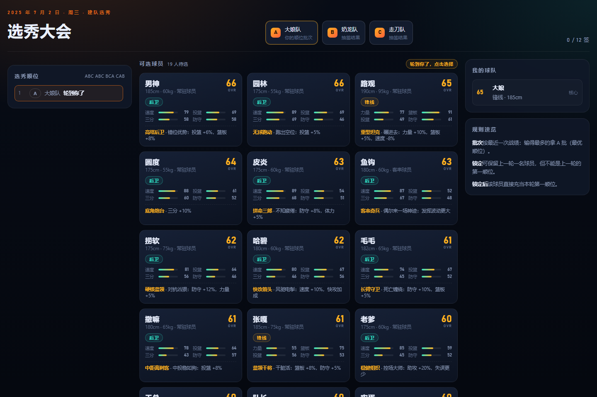
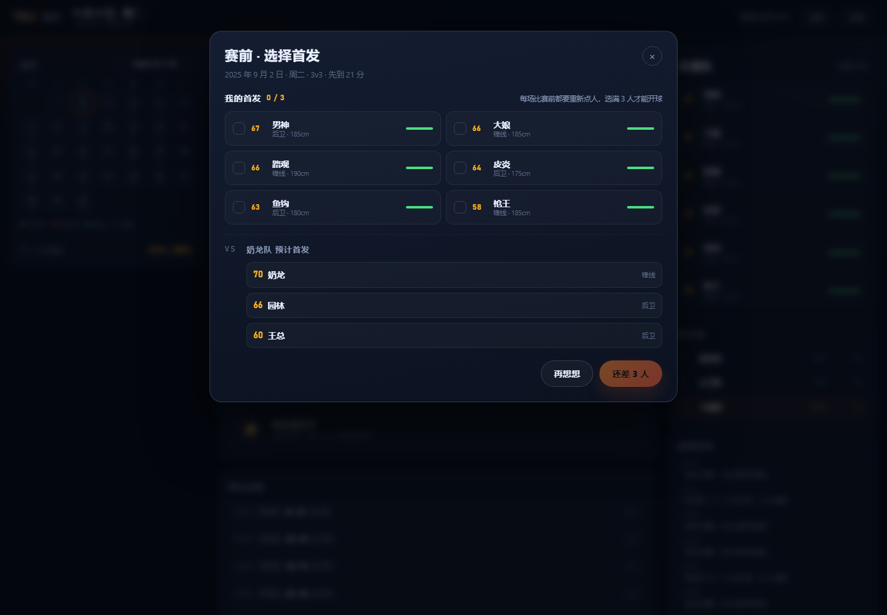
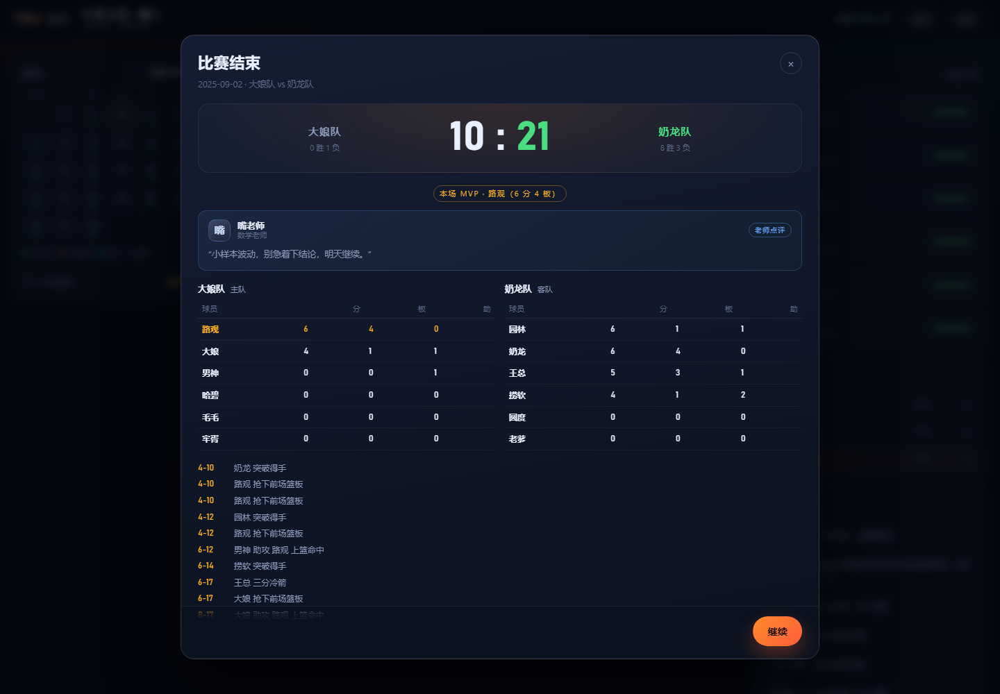
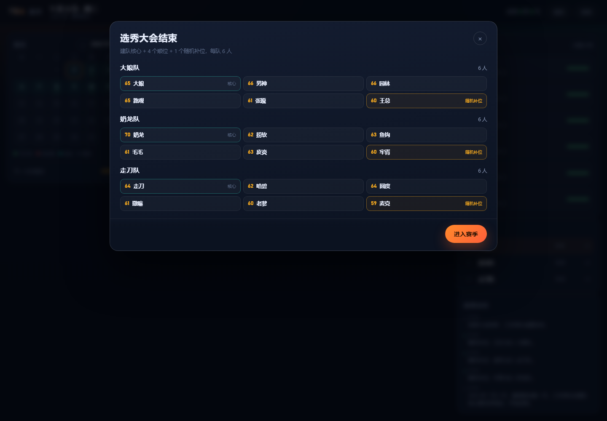

# TBA 模拟器 · 篮途


一个用班级篮球联盟的真实资料做出来的浏览器模拟经营游戏雏形。

你扮演「大娘」——球队总经理兼首发大前锋，从 2025 年 7 月 2 日暑假留校开始，经历选秀、体育课、考试周、寒假留校，一路打到 2026 年 6 月 9 日。

> 当前版本 **v1.1.3**：只开放「大娘」一个角色，奶龙与走刀待解锁。

## 开始玩

- **在线**：<https://daitangchen.github.io/TBA/>
- **本地**：下载仓库后双击 `index.html`，不需要服务器、不需要安装依赖。

## 这一版有什么

| 系统 | 说明 |
| --- | --- |
| 赛历 | 完全按 `schedule.md` 还原：暑假 / 寒假、留校、体育课、小考试、大考试、留校最后一天不打 |
| 选秀 | 三支球队、A / B / C 批次、`ABC ABC BCA CAB` 共 12 个签位；选完再从剩余球员里随机补 1 人，每队 5 名新秀 |
| 中期选秀 | 2026-02-05 触发，批次按最近战绩（输得最多拿 A 批），可锁定上一轮球员 |
| 赛前选人 | **每场比赛前都要手动点 3 名首发**，可以按对手和体力临时换人 |
| 比赛 | 3v3、先到 21 分且领先 2 分；逐回合模拟，产出得分 / 篮板 / 助攻与关键回合 |
| 老师点评 | 常规上学日每天一位老师点评你的球队，赛后还会补两句 |
| 养成 | 全队训练、体力、伤病、随机校园事件 |
| 存档 | 浏览器 localStorage 自动保存，刷新后继续 |

## 截图

| 选秀大会 | 赛季主界面 |
| --- | --- |
|  |  |

| 赛前选人 | 老师点评（上课日） |
| --- | --- |
|  |  |

| 比赛结算 | 赛季结算 |
| --- | --- |
|  |  |

| 选秀总结（含随机补位） | 中期选秀锁定 |
| --- | --- |
|  |  |

## 数据与规则来源

| 文件 | 用途 |
| --- | --- |
| `球员信息表.et` | 22 名球员的姓名、身份、位置、身高、体重；6 位老师作为剧情 NPC |
| `rules.png` | 建队核心、选秀批次、锁定规则、交易市场 |
| `schedule.md` | 赛季时间轴与「哪天能打球」的全部规则 |

### 属性怎么来的

球员信息表里只有身高、体重、位置，所以七项属性（投篮、三分、篮板、速度、力量、防守、体能）由它们推导，再用名字做稳定抖动，保证同一名球员每次开档数值一致：

- 力量、篮板随身高体重上升；
- 速度随身高体重下降，后卫有加成；
- 特性来自表格里预留的「特性一（球场特性）」列，目前是这一版的设计填充。

### 规则实现说明

- **选秀顺序**按图一底部的 `ABC ABC BCA CAB` 实现（每队 4 签，共 12 签）。
- **随机补位**：`rules.png` 只规定了 4 个顺位，所以选秀结束后每队会从剩余球员里随机获得第 5 名新秀，队伍最终 6 人（建队核心 + 5）。
- **批次表**（A: 1/2/2/3 等）在界面里作为参考展示；如果后续确认它描述的是另一种签位分配，改 `assets/js/data.js` 里的 `DRAFT_ORDER` 即可。
- 22 名球员里 3 名核心 + 每队 5 名新秀 = 18 人进队，剩下 4 人进入自由球员池（后续版本再开放签约）。
- **交易市场**（`rules.png` 第③条）这一版还没有实现，已排进后续版本。
- 比赛做成 3v3：每队 6 人，3 首发 + 3 替补；**首发每场赛前手动选**，不选满 3 人开不了球。
- **老师点评**：按星期轮值一位老师（周一特老师、周二嘴老师、周三彤老师、周四搓老师、周五猫老师、周末秦始皇），只在「正常上学」的非考试日出现；赛后在比赛结算里再补一句，输赢台词不同。

## 操作

- 日历上的绿点表示可以打球的日子，鼠标悬停可以看到当天的规则。
- 可打球日可以「约战」或「全队训练」，其他日子只能休息或快进。
- 点「约战」后必须从 6 人里点选 3 名首发才能开球，每场都要重新选。
- 点击右侧阵容里的球员，可以查看属性详情。
- `Esc` 关闭弹窗。

## 开发

```
index.html                 入口（双击即玩）
assets/css/style.css       全部样式
assets/js/data.js          球员、赛历、事件、配置（改数据先看这里）
assets/js/core.js          日历判定、属性、选秀、比赛模拟、存档
assets/js/ui.js            界面渲染与交互
tests/test-core.js         赛历 / 选秀 / 比赛 / 整季推进
tests/test-lock.js         中期选秀与锁定规则
docs/screenshots/          截图
```

跑测试（只需要 Node）：

```bash
node tests/test-core.js
node tests/test-lock.js
```

### 演示参数

给截图和演示用，会直接跳过标题页（注意：会覆盖本地存档）：

- `index.html?demo=draft` 停在选秀现场
- `index.html?demo=main` 选完秀并推进到可打球日
- `index.html?demo=summary` 直接看选秀结束的阵容总结（含随机补位）
- `index.html?demo=lineup` 打开赛前选首发
- `index.html?demo=school` 停在正常上学的日子（看老师点评）
- `index.html?demo=schoolmatch` 在上学日打一场并看赛后点评
- `index.html?demo=match` 直接看一场比赛结算
- `index.html?demo=lock` 快进到 2026-02-05 的中期选秀锁定阶段
- `index.html?demo=end` 快进到赛季结束

## 更新日志

- **v1.1.3**：每场比赛前手动选择 3 名首发；常规上学日加入老师点评，赛后也有对应点评。详见 [CHANGELOG.md](CHANGELOG.md)。
- **v1.1.2**：修复选秀结束后「进入赛季」卡死的问题；每队随机补位第 5 名新秀（队伍 6 人）。
- **v1.1.1**：首个可玩雏形（赛历、选秀、3v3 比赛、赛季主界面、存档、中期选秀）。

## 路线图

- **v1.2**：交易市场（含建队核心对第二顺位球员交易的一票否决）、自由球员签约、任选操控角色（奶龙 / 走刀）、更丰富的老师 NPC 事件、音效。
- **v1.3**：赛季奖项（MVP / 得分王）、球员成长曲线、竖屏适配打磨。

---

数据来自班级内部资料，仅作学习娱乐用途。
