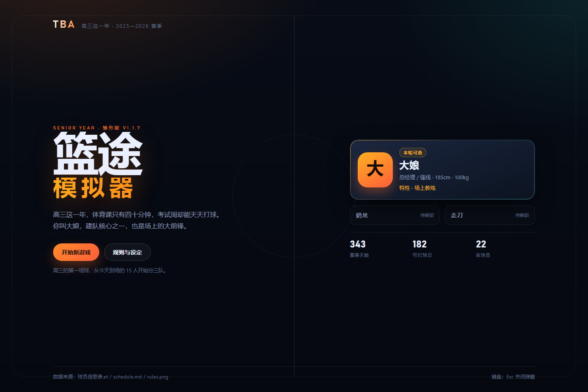
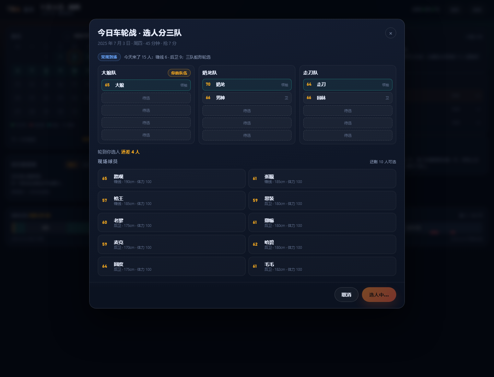
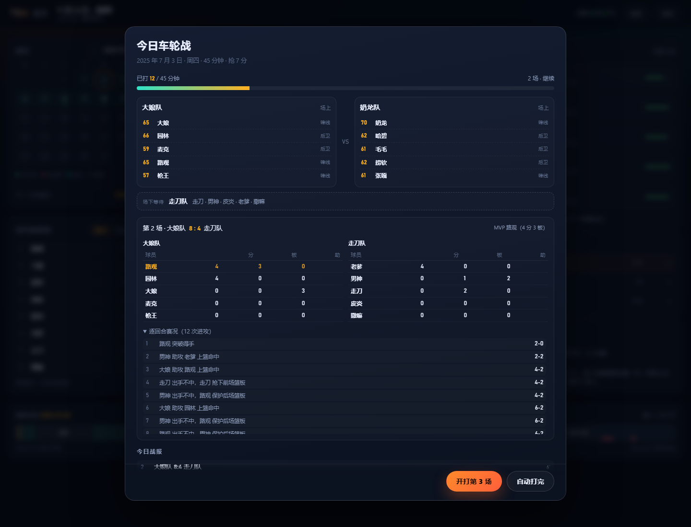
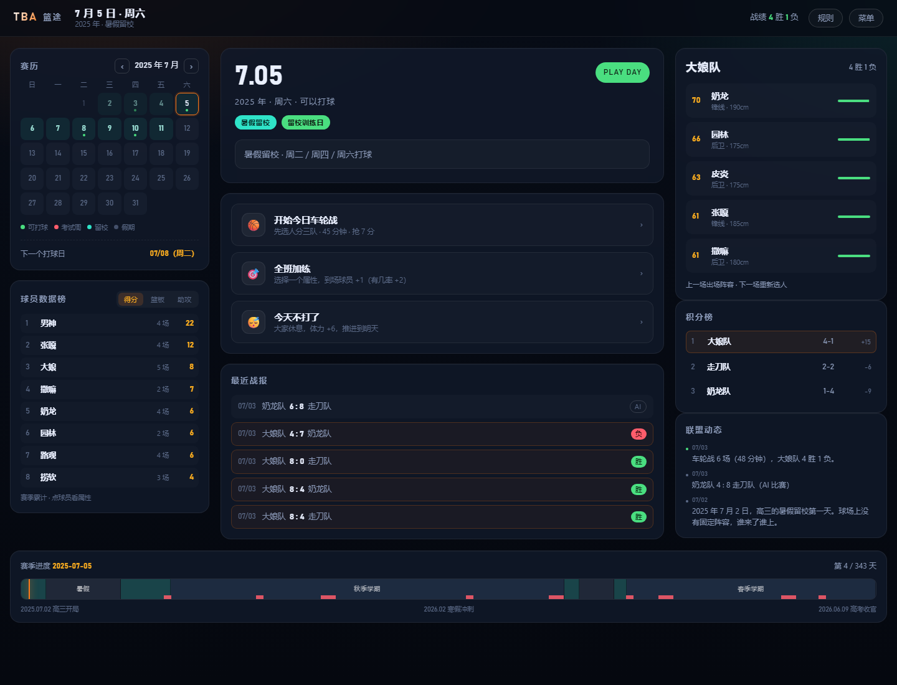
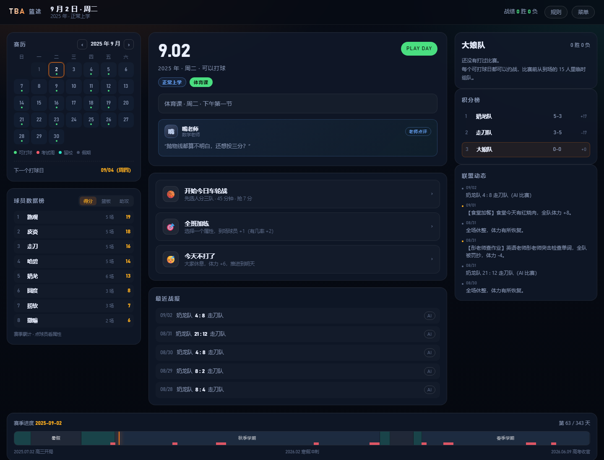
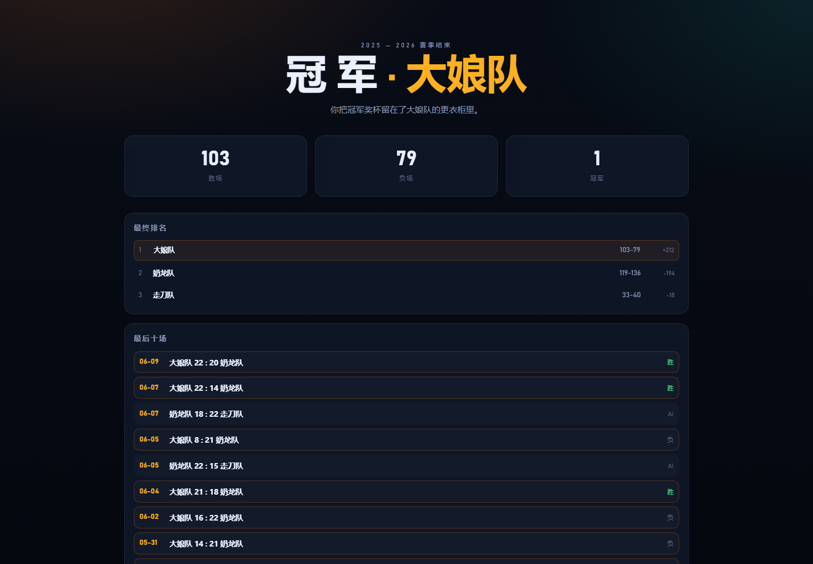

# TBA 模拟器 · 篮途



高三这一年，体育课只有四十分钟，考试周却能天天打球。

你扮演「大娘」——建队核心之一，场上的大前锋。每天到场 15 人，先分三队，再打一轮 45 分钟的车轮战：**输的下场，赢的留场**。

> 当前版本 **v1.1.7**：只开放「大娘」一个角色，奶龙与走刀待解锁。

## 开始玩

- **在线**：<https://daitangchen.github.io/TBA/>
- **本地**：下载仓库后双击 `index.html`，不需要服务器、不需要安装依赖。

## 这一版有什么

| 系统 | 说明 |
| --- | --- |
| 赛历 | 完全按 `schedule.md` 还原：暑假 / 寒假、留校、体育课、小考试、大考试、留校最后一天不打 |
| 到场 15 人 | 每天生成到场名单：**锋线全来，后卫随机来，客串球员只在考试期间出现**，总数固定 15（含领袖） |
| 三队选人 | 每天开始时 15 人分成三队，每队 5 人（领袖 + 4 人），三队蛇形轮选 |
| 每日车轮战 | 大娘队先上场，输的下场、场下那队上来、赢的留在场上，一直打到 **45 分钟**用完 |
| 分数制 | **平日抢 7 分，周日抢 21 分**，先到目标分的一方获胜 |
| 单场数据 | 每场结束立刻给出双方球员的**得分 / 篮板 / 助攻**和本场 MVP |
| 逐回合赛况 | 每一次进攻都有记录：谁出手、命中与否、篮板、助攻、当时比分 |
| 球员数据榜 | 左下角赛季累计榜，可在得分 / 篮板 / 助攻之间切换 |
| 高三线 | 2025.7.2 暑假留校开局，2026.6.9 高考结束，赛季同日收官 |
| 老师点评 | 常规上学日每天一位老师点评，赛后还有输赢点评 |
| 养成 | 全班加练、体力、伤病、随机校园事件 |
| 存档 | 浏览器 localStorage 自动保存，刷新后继续 |

## 截图

| 三队选人（15 人池） | 车轮战进行中（含单场数据与逐回合） |
| --- | --- |
|  |  |

| 赛季主界面 | 老师点评（上课日） |
| --- | --- |
|  |  |



## 数据与规则来源

| 文件 | 用途 |
| --- | --- |
| `球员信息表.et` | 22 名球员的姓名、身份、位置、身高、体重；6 位老师作为剧情 NPC |
| `rules.png` | 建队核心（大娘 / 奶龙 / 走刀）与联盟规则参考 |
| `schedule.md` | 赛季时间轴与「哪天能打球」的全部规则 |

### 属性怎么来的

球员信息表里只有身高、体重、位置，所以七项属性（投篮、三分、篮板、速度、力量、防守、体能）由它们推导，再用名字做稳定抖动，保证同一名球员每次开档数值一致：

- 力量、篮板随身高体重上升；
- 速度随身高体重下降，后卫有加成；
- 特性来自表格里预留的「特性一（球场特性）」列，目前是这一版的设计填充。

### 规则实现说明

- **每天 15 人**：6 名锋线（含三位领袖）一定到场；再从后卫里随机抽 9 人。常规日只有 11 名常驻后卫，所以每次会有 2 人「没来」；考试期间客串球员加入候选。
- **三队蛇形轮选**：15 人全部分完，每队 5 人（领袖 + 4 人）；别人家的领袖（比如走刀）也可能被你选进队里。
- **车轮战**：大娘队和随机一队先打，第三队场下等；每场结束后**输的下场、场下的上场、赢的留在场上**，直到累计时间达到 45 分钟（最后一场打完为止）。
- **比分**：平日抢 7 分、周日抢 21 分；抢 7 不需要领先 2 分，抢 21 需要。
- **比赛时长**：按攻防回合折算（0.5 分钟 / 回合），所以抢 7 一场大约 5—9 分钟，抢 21 一场大约 15—20 分钟。
- **首发**：每队 5 人里按综合和体力排 3 人首发，领袖必首发。
- **单场数据与赛况**：每场结束展示双方球员得分 / 篮板 / 助攻和 MVP；进攻日志逐回合记录出手、命中、篮板、助攻和比分。
- **球员数据榜**：赛季累计（出场、得分、篮板、助攻）显示在左下角，点球员可看属性。
- **旧版「每场重新组队」**已升级为「每天分组 + 车轮战」；交易市场（`rules.png` 第③条）仍未实现。

## 操作

- 日历上的绿点表示可以打球的日子，鼠标悬停可以看到当天的规则。
- 可打球日点「开始今日车轮战」→ 三队蛇形轮选（你选 4 人）→ 车轮战（可以逐场开打，也可以「自动打完」）→ 45 分钟到点后看当天战报。
- 车轮战界面下方会显示刚打完那场的球员数据和逐回合赛况，可展开 / 收起。
- 左下角「球员数据榜」可切换得分 / 篮板 / 助攻，点击球员查看属性。
- 点击右侧「上一场出场阵容」里的球员，也可以查看属性详情。
- `Esc` 关闭弹窗。

## 开发

```
index.html                 入口（双击即玩）
assets/css/style.css       全部样式
assets/js/data.js          球员、赛历、老师台词、事件、配置（改数据先看这里）
assets/js/core.js          日历判定、属性、15 人池、三队分组、车轮战、比赛模拟、存档
assets/js/ui.js            界面渲染与交互
tests/test-core.js         赛历 / 15 人池 / 三队选人 / 车轮战 / 周日 21 分制 / 整季推进
docs/screenshots/          截图
```

跑测试（只需要 Node）：

```bash
node tests/test-core.js
```

### 演示参数

给截图和演示用，会直接跳过标题页（注意：会覆盖本地存档）：

- `index.html?demo=team` 打开三队选人界面
- `index.html?demo=session` 直接进入车轮战（已打两场）
- `index.html?demo=main` 打完一轮车轮战后回主界面
- `index.html?demo=school` 停在正常上学日（看老师点评）
- `index.html?demo=schoolmatch` 在上学日打一轮车轮战
- `index.html?demo=end` 快进到高考结束

## 更新日志

- **v1.1.7**：每场给出球员数据和逐回合赛况，左下角新增赛季球员数据榜。详见 [CHANGELOG.md](CHANGELOG.md)。
- **v1.1.6**：每日车轮战——每天先分三队，输的下场、赢的留场，打满 45 分钟；平日抢 7 分、周日抢 21 分。
- **v1.1.5**：每场比赛前从「到场 15 人」重新组队；考试周每天晚上都能打球；背景改为高三。
- **v1.1.3**：每场比赛前手动选首发；常规上学日加入老师点评。
- **v1.1.2**：修复选秀结束后「进入赛季」卡死；每队随机补位第 5 名新秀。
- **v1.1.1**：首个可玩雏形。

## 路线图

- **v1.2**：交易市场、任选操控角色（奶龙 / 走刀）、更丰富的老师 NPC 事件、音效。
- **v1.3**：赛季奖项（MVP / 得分王）、球员成长曲线、竖屏适配打磨。

---

数据来自班级内部资料，仅作学习娱乐用途。
